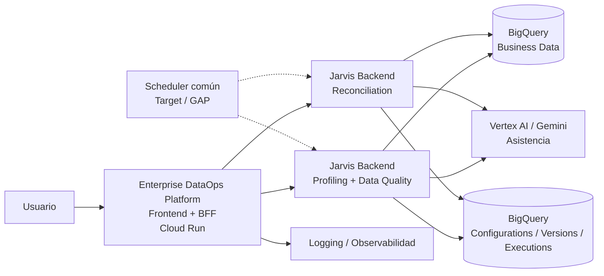
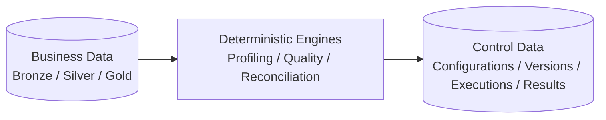
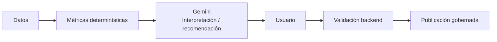
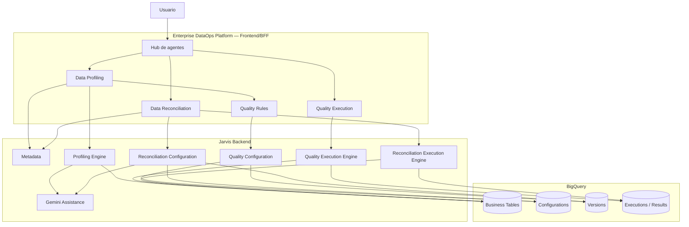
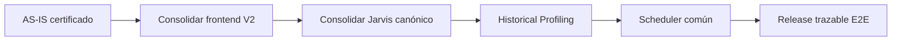

# Arquitectura AS-IS — Enterprise DataOps Demo

**Estado:** REVIEWED  
**Fecha:** 2026-08-24  
**Frontend de referencia:** https://enterprise-dataops-platform-ui-mkqutd4koq-uc.a.run.app  
**Repositorio frontend/BFF:** `JuliusCordova/enterprise-dataops-platform-ui`  
**Backend Quality / Profiling / Reconciliation:** `JuliusCordova/intercorp-fest-agent`

> Esta arquitectura describe el comportamiento y ownership observados de la demo actual. La URL Cloud Run se considera referencia funcional/visual; la relación exacta de la revisión desplegada con SHA e image digest permanece `TO_VALIDATE` hasta completar certificación de release.

## 1. Objetivo

Documentar una vista única de la demo para alinear:

- experiencia web;
- BFF y adapters;
- motores de Perfilamiento, Calidad y Reconciliación;
- BigQuery como fuente de datos y persistencia técnica;
- Gemini como asistencia explicativa/recomendadora;
- observabilidad y trazabilidad;
- brechas conocidas hacia el target.

## 2. Vista de contexto AS-IS

## 3. Frontend / BFF

El frontend actual de referencia está desplegado en:

`https://enterprise-dataops-platform-ui-mkqutd4koq-uc.a.run.app`

Responsabilidades del repositorio `enterprise-dataops-platform-ui`:

- hub principal de agentes;
- Data Profiling;
- Quality Rules;
- Quality Execution;
- Data Reconciliation;
- navegación y journeys guiados;
- DTOs y adapters hacia backends;
- composición de resultados para UX;
- documentación funcional y arquitectónica del producto.

### Regla de separación

El frontend/BFF **no** debe implementar el motor determinístico de:

- perfilamiento;
- evaluación de reglas de calidad;
- reconciliación/cuadratura.

Tampoco debe presentar `SUCCESS` local cuando el backend real falla o no responde.

## 4. Backend Jarvis

Repositorio ejecutable identificado:

`JuliusCordova/intercorp-fest-agent`

Ownership funcional:

- metadata;
- profiling;
- sugerencias/soporte de configuración de calidad;
- lifecycle canónico de Data Quality;
- ejecución de reglas de calidad;
- lifecycle canónico de Reconciliation;
- ejecución operativa de cuadratura;
- resultados/latest;
- integración con Gemini donde corresponda.

### Estado técnico relevante

La implementación canónica revisada se encuentra actualmente en `feature/data-quality-engine` y aún debe consolidarse controladamente en `main` después de los gates de release.

Para Reconciliation coexisten:

1. lifecycle canónico/versionado de configuraciones;
2. motor operativo de ejecución.

La convergencia completa debe asegurar que toda ejecución utilice y registre el mismo `configuration_id` + `version_id` canónico publicado.

## 5. BigQuery

En la demo BigQuery cumple dos papeles que deben mantenerse conceptualmente separados.

### 5.1 Business Data

Datos que el producto analiza:

- tablas a perfilar;
- datasets Bronze/Silver/Gold usados por la demo;
- tablas origen y destino de las cuadraturas.

### 5.2 Control / Governance Data

Persistencia técnica/gobernada de:

- configuraciones;
- versiones;
- ejecuciones;
- resultados/evidencia;
- metadata técnica asociada al lifecycle.

## 6. Rol de Gemini

Gemini actúa como **asistente**, no como motor de decisión determinística.

Puede participar en:

- lectura ejecutiva del perfil;
- interpretación de métricas;
- sugerencia de posibles claves;
- sugerencia de reglas de calidad;
- recomendación de métricas para cuadratura;
- explicación contextual de hallazgos.

No debe:

- publicar una regla automáticamente;
- cambiar tolerancias sin aprobación/contrato;
- decidir por sí solo el estado final de una cuadratura;
- sustituir las métricas reales calculadas por backend.

## 7. Arquitectura funcional de los journeys

## 8. Flujos funcionales asociados

### Data Quality

`Hub → Seleccionar tabla → Perfilar → Informe/hallazgos → Diseñar reglas → Guardar draft → Validar → Publicar/versionar → Quality Execution → Ejecutar → Resultados`

La especificación normativa y evidencia visual están en:

- `../sdd/SPEC-001-data-quality-lifecycle.md`;
- `../sdd/ui-journey-evidence.md`.

### Reconciliation

Desde el catálogo existen dos rutas:

- `Existente → seleccionar ACTIVE → business_date → ejecutar cuadratura`;
- `Nueva → origen/destino → análisis → claves/métricas → reglas/tolerancias → guardar → validar → publicar → catálogo → ejecutar`.

La especificación normativa y evidencia visual están en:

- `../sdd/SPEC-002-reconciliation-lifecycle.md`;
- `../sdd/ui-journey-evidence.md`.

## 9. Capacidades transversales

La arquitectura debe aplicar transversalmente:

- identidad y mínimo privilegio;
- secretos fuera del código;
- validación de identificadores y filtros;
- audit trail para save/validate/publish/execute;
- correlation/trace ID;
- métricas de latencia/error/ejecución;
- trazabilidad frontend SHA ↔ backend SHA ↔ image digest;
- versionado inmutable de configuraciones publicadas;
- evidencia de pruebas y smoke.

## 10. Brechas conocidas

### GAP-01 — Historical Profiling

El profiler actual no implementa todavía corte histórico parametrizado por `business_date`, rango, filtro gobernado o snapshot/time-travel.

### GAP-02 — Scheduling común

No se encontró scheduler persistente certificado para Quality y Reconciliation. El target debe disparar los mismos endpoints/motores usados por `ON_DEMAND`.

### GAP-03 — Convergencia Reconciliation lifecycle ↔ execution

La ejecución operativa debe registrar y utilizar de forma inequívoca la configuración y versión canónica publicada.

### GAP-04 — Release traceability

La URL Cloud Run es conocida, pero falta certificar:

`Frontend URL → Cloud Run revision → image digest → Git SHA`

Y la misma cadena para los backends propietarios.

## 11. Target inmediato

La evolución recomendada es:

## 12. Regla de gobierno

Toda modificación de esta arquitectura que cambie ownership, contratos, ejecución o persistencia debe actualizar en el mismo incremento:

1. arquitectura;
2. SPEC correspondiente;
3. RF/RNF;
4. Mermaid del journey;
5. contrato API;
6. pruebas/evidencia;
7. referencia de release.
