# SPEC-001 — Data Profiling & Quality Lifecycle

**Estado:** REVIEWED  
**Dominio:** Data Quality  
**Frontend/BFF:** `enterprise-dataops-platform-ui`  
**Frontend actual:** [Enterprise DataOps Platform — Cloud Run](https://enterprise-dataops-platform-ui-mkqutd4koq-uc.a.run.app)  
**Backend ejecutable:** `JuliusCordova/intercorp-fest-agent`

> El frontend indicado es la referencia funcional/visual actual. La revisión desplegada aún debe certificarse contra SHA de GitHub e image digest.

## 1. Problema

Los equipos necesitan validar rápidamente la condición de una tabla, tanto sobre datos actuales como sobre periodos históricos, convertir los hallazgos en reglas de calidad gobernadas y ejecutar esas reglas de forma repetible sin escribir lógica ad hoc en cada análisis.

## 2. Outcome

Permitir que un usuario complete el siguiente ciclo:

`Seleccionar fuente → Perfilar → Entender hallazgos → Crear reglas → Validar → Publicar/versionar → Ejecutar → Observar resultados`

La ejecución deberá soportar dos modos:

- `ON_DEMAND`;
- `SCHEDULED`.

## 2.1 Journey UX validado

Las capturas revisadas el 2026-08-24 consolidan cinco macroetapas del journey:

1. **Pantalla principal de agentes**: ingreso al hub único de Enterprise DataOps.
2. **Seleccionar tabla y perfilar**: conexión → dataset → tabla → análisis → informe inteligente de perfilado.
3. **Crear reglas y validar configuración**: transformar hallazgos en reglas sugeridas/editables, guardar draft y validar con backend.
4. **Confirmar y publicar**: publicación explícita únicamente después de una validación backend satisfactoria.
5. **Ir a ejecución de reglas**: seleccionar una configuración `ACTIVE` del catálogo y ejecutar la evaluación.

La evidencia visual está catalogada en [`ui-journey-evidence.md`](ui-journey-evidence.md), referencias `UI-DQ-01` a `UI-DQ-08`.

### Flujo Mermaid normativo

```mermaid
flowchart LR
    A["1. Hub principal de agentes"] --> B["2. Seleccionar conexión, dataset y tabla"]
    B --> C["Ejecutar perfilamiento"]
    C --> D["Informe inteligente: score, métricas y hallazgos"]
    D --> E["3. Crear reglas recomendadas"]
    E --> F["Ajustar / agregar reglas"]
    F --> G["Guardar borrador"]
    G --> H["Validar configuración en backend"]
    H --> I{"¿VALID?"}
    I -- "No" --> F
    I -- "Sí" --> J["4. Confirmar y publicar"]
    J --> K["Configuración ACTIVE / versión PUBLISHED"]
    K --> L["5. Quality Execution: catálogo de controles"]
    L --> M["Seleccionar configuración + business_date opcional"]
    M --> N["Ejecutar evaluación"]
    N --> O["Resultado, issues y evidencia"]
```

### Principios de interacción derivados de la evidencia

- La navegación no debe crear aplicaciones separadas para Profiling, Rules y Execution; son etapas del mismo producto.
- El resultado del perfil debe transportar el contexto de fuente/tabla hacia el diseño de reglas.
- Las recomendaciones de Gemini son propuestas editables, no decisiones publicadas automáticamente.
- `Guardar borrador`, `Validar configuración` y `Confirmar y publicar` son acciones distintas y auditables.
- La ejecución solo opera sobre una configuración publicada/activa.
- Si el frontend pierde el contexto del perfilado, no debe continuar silenciosamente: debe recuperar el estado o solicitar un nuevo perfilado explícito.

## 3. Alcance funcional

### 3.1 Descubrimiento

El usuario selecciona:

- conexión;
- proyecto/dataset;
- tabla;
- columnas opcionales;
- clave de negocio opcional;
- columna de fecha opcional;
- filtro de negocio opcional.

### 3.2 Perfilamiento

El sistema debe producir como mínimo:

- conteo de filas;
- tipo de dato;
- nulos y porcentaje de nulos;
- cardinalidad/distintos;
- mínimo, máximo, promedio y desviación estándar para numéricos;
- metadata suficiente para soportar diseño de reglas.

El informe UX podrá complementar estas métricas con:

- score/readiness derivado;
- posibles claves;
- observaciones priorizadas;
- lectura ejecutiva;
- recomendaciones de reglas.

Todo indicador derivado debe poder trazarse a métricas reales de backend y a su versión de cálculo.

#### Perfil actual

Ejecuta sobre el estado vigente de la tabla.

#### Perfil histórico

Debe permitir repetir el perfil sobre una ventana o corte histórico mediante uno de estos patrones, según la fuente:

- `business_date` + `date_column`;
- rango `from/to`;
- filtro gobernado;
- snapshot/time-travel cuando la tecnología lo permita.

El corte utilizado debe persistirse junto con el resultado para permitir comparación y auditoría.

## 4. Diseño de reglas de calidad

A partir del perfil, el usuario podrá crear reglas manualmente o desde sugerencias. Toda sugerencia debe ser editable y debe pasar por validación antes de publicarse.

Una regla debe incluir como mínimo:

- nombre;
- dimensión de calidad;
- tipo de regla;
- columna o columnas afectadas;
- parámetros;
- umbral warning;
- umbral critical;
- severidad;
- estado activo/inactivo.

Ejemplos de tipos: completitud, unicidad, dominio permitido, rango, patrón, comparación entre columnas, integridad de clave y consistencia temporal.

La UX validada muestra, entre otros, tipos sugeridos como `NOT_NULL`, `UNIQUE`, `ALLOWED_VALUES` y `VALUE_RANGE`.

## 5. Ciclo de vida de configuración

Estados de configuración:

`DRAFT → ACTIVE ↔ INACTIVE → ARCHIVED`

Estados de versión:

`DRAFT → PUBLISHED → SUPERSEDED`

Reglas:

1. una configuración publicada es inmutable;
2. una modificación de una configuración publicada genera nueva versión;
3. una ejecución registra la versión exacta utilizada;
4. el archivado es lógico;
5. el historial no se elimina;
6. una validación `VALID` habilita la acción de publicación, pero no publica por sí sola.

## 6. Ejecución

### 6.1 On-demand

El usuario selecciona una configuración `ACTIVE`, opcionalmente un `business_date`, y solicita una ejecución inmediata.

La ejecución debe generar:

- `execution_id`;
- configuration/version ID;
- timestamps;
- modo de ejecución;
- estado;
- métricas por regla;
- issues/incumplimientos;
- resumen global;
- evidencia de error cuando corresponda.

La UX debe mostrar un catálogo de configuraciones activas con búsqueda/filtro y un panel explícito de preparación de la evaluación.

### 6.2 Programada

Una configuración podrá asociarse a una programación versionada que incluya:

- frecuencia/cron;
- timezone;
- fecha de inicio;
- estado enabled/disabled;
- parámetros de fecha de negocio;
- política de reintentos;
- owner.

El scheduler no debe contener la lógica de calidad; únicamente dispara la misma operación de ejecución utilizada por `ON_DEMAND`.

## 7. Contratos principales

Backend revisado actualmente:

- `POST /data-quality/profile`
- `GET /data-quality/rule-types`
- `POST /data-quality/configure/draft`
- `GET /data-quality/configure/draft/{draft_id}`
- `PUT /data-quality/configure/draft/{draft_id}`
- `POST /data-quality/configure/validate/{draft_id}`
- `POST /data-quality/configure/confirm/{draft_id}`
- `POST /data-quality/execute`
- `GET /data-quality/result/{execution_id}`
- `GET /data-quality/latest/{quality_config_id}`
- CRUD canónico bajo `/data-quality/configurations*`.

El BFF debe exponer rutas estables propias y encapsular diferencias legacy/canónicas.

## 8. Criterios de aceptación

### AC-DQ-01 — Perfil actual

Dada una tabla BigQuery válida, cuando el usuario solicita perfilamiento, entonces recibe métricas reales calculadas sobre la tabla seleccionada y no valores simulados en frontend.

### AC-DQ-02 — Perfil histórico

Dada una tabla con columna temporal y un corte histórico, cuando el usuario solicita perfilamiento para ese corte, entonces todas las métricas corresponden exclusivamente al periodo solicitado y el corte queda trazado en el resultado.

### AC-DQ-03 — Regla gobernada

Una regla no puede publicarse sin pasar validación de estructura, referencias, parámetros y compatibilidad con la tabla/columnas seleccionadas.

### AC-DQ-04 — Publicación/versionado

Publicar una configuración crea una versión inmutable; modificarla posteriormente crea una nueva versión y conserva la anterior.

### AC-DQ-05 — On-demand

Una configuración `ACTIVE` puede ejecutarse a demanda y devuelve `execution_id`, estado, métricas e issues.

### AC-DQ-06 — Scheduled

Una programación habilitada dispara la misma ejecución gobernada, registra `execution_mode=SCHEDULED` y conserva trazabilidad del schedule que la originó.

### AC-DQ-07 — Auditoría

Para cualquier ejecución debe poder reconstruirse quién/qué la disparó, configuración y versión, fuente, corte de datos, resultado y evidencia técnica.

### AC-DQ-08 — Continuidad Perfil → Reglas

Cuando el usuario selecciona `Crear reglas recomendadas` desde un perfil válido, el draft debe heredar la fuente, tabla, columnas y referencia/contexto del perfil que originó las recomendaciones.

### AC-DQ-09 — Gate de publicación

`Confirmar y publicar` solo debe estar habilitado después de una validación backend válida para el draft/versión actual. Si el draft cambia después de validar, debe invalidarse o repetirse la validación según contrato.

### AC-DQ-10 — Disponibilidad para ejecución

Después de publicar una configuración, esta debe aparecer en el catálogo de Quality Execution como `ACTIVE` y toda ejecución debe registrar la versión exacta publicada.

### AC-DQ-11 — Recuperación de contexto

Si el frontend no encuentra el resultado/contexto del perfil utilizado para diseñar reglas, debe impedir una publicación inconsistente y ofrecer recuperación o reejecución explícita del perfilado.

## 9. Cobertura actual

| Capacidad | Estado |
|---|---|
| Hub único / navegación del journey | IMPLEMENTED / evidencia visual; release exacto TO_VALIDATE |
| Selección de conexión/dataset/tabla | IMPLEMENTED / TO_VALIDATE runtime |
| Perfil actual BigQuery | IMPLEMENTED |
| Informe visual de perfilado | IMPLEMENTED / evidencia visual; cálculo derivado TO_VALIDATE |
| Perfil histórico parametrizado | GAP |
| Perfil → reglas recomendadas | IMPLEMENTED/PARTIAL; trazabilidad de contexto TO_VALIDATE |
| Draft y validación de reglas | IMPLEMENTED |
| Confirmación/publicación UX | IMPLEMENTED / evidencia visual |
| CRUD/versionado/publicación canónica | IMPLEMENTED en backend branch |
| Ejecución on-demand | IMPLEMENTED |
| Catálogo Quality Execution | IMPLEMENTED / evidencia visual; release exacto TO_VALIDATE |
| Consulta latest/result | IMPLEMENTED |
| Scheduling persistente | GAP |
| Trazabilidad frontend ↔ backend ↔ release | PARTIAL |

## 10. Fuera de alcance de esta SPEC

- transformación Bronze → Silver;
- generación de pipelines de ingesta;
- corrección automática de datos productivos;
- persistencia duplicada de reglas en frontend.
