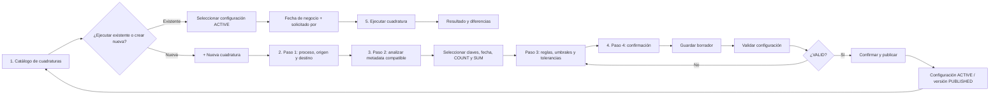

# SPEC-002 — Reconciliation / Cuadratura Lifecycle

**Estado:** REVIEWED  
**Dominio:** Reconciliation  
**Frontend/BFF:** `enterprise-dataops-platform-ui`  
**Frontend actual:** [Enterprise DataOps Platform — Cloud Run](https://enterprise-dataops-platform-ui-mkqutd4koq-uc.a.run.app)  
**Backend ejecutable:** `JuliusCordova/intercorp-fest-agent`

> El frontend indicado es la referencia funcional/visual actual. La revisión desplegada aún debe certificarse contra SHA de GitHub e image digest.

## 1. Problema

Los equipos necesitan comprobar rápidamente que los datos de un origen y un destino cuadran después de una carga, transformación o proceso de negocio, evitando scripts manuales no versionados y dejando evidencia repetible de la comparación.

## 2. Outcome

Permitir el ciclo:

`Seleccionar cuadratura existente o crear nueva → Definir origen/destino → Analizar metadata y métricas → Definir reglas/tolerancias → Validar → Publicar/versionar → Ejecutar → Analizar diferencias`

La ejecución deberá soportar:

- `ON_DEMAND`;
- `SCHEDULED`.

## 2.1 Journey UX validado

Las capturas revisadas el 2026-08-24 consolidan dos rutas de entrada y cinco macroetapas:

1. **Seleccionar cuadratura o crear una nueva** desde el catálogo.
2. **Definir origen y destino** mediante wizard guiado.
3. **Analizar tablas y seleccionar métricas** con recomendaciones de Gemini bajo control del usuario.
4. **Confirmar y publicar** una configuración validada/versionada.
5. **Ejecutar la cuadratura** desde el catálogo sobre una configuración `ACTIVE`.

La evidencia visual está catalogada en [`ui-journey-evidence.md`](ui-journey-evidence.md), referencias `UI-REC-01` a `UI-REC-05`.

### Flujo Mermaid normativo

### Principios de interacción derivados de la evidencia

- El catálogo es el punto de entrada tanto para ejecución on-demand como para creación de una nueva cuadratura.
- Crear una nueva cuadratura debe resolverse mediante un wizard que preserve estado entre pasos.
- Gemini puede recomendar columnas, claves y métricas, pero el usuario mantiene la decisión final.
- La compatibilidad de metadata origen ↔ destino es un gate previo al diseño/publicación.
- `Guardar borrador`, `Validar configuración` y `Confirmar y publicar` son acciones separadas y auditables.
- Una cuadratura publicada debe volver al catálogo como configuración `ACTIVE` y ejecutable.

## 3. Selección de activos

El usuario debe poder navegar metadata de conexiones y seleccionar para ambos lados:

- `connection_id`;
- proyecto/base cuando corresponda;
- dataset/schema;
- tabla;
- columnas.

El BFF no inventa metadata y no permite publicar referencias inexistentes.

Para cada lado la UX podrá ofrecer un filtro opcional gobernado, por ejemplo asociado a `business_date`, siempre que el backend valide su seguridad y compatibilidad.

## 4. Definición de cuadratura

Una configuración debe permitir como mínimo:

- nombre y descripción;
- dominio/owner;
- activo origen;
- activo destino;
- clave(s) de negocio;
- columna de fecha de negocio;
- columnas de conteo;
- columnas/expresiones agregables;
- filtros de origen y destino;
- tolerancia de filas;
- tolerancias por métrica;
- reglas de matching;
- parámetros de ejecución.

### 4.1 Wizard funcional validado

El wizard debe preservar, como mínimo, estas etapas:

1. **Origen y destino**: proceso, dominio, descripción, conexiones/datasets/tablas y filtros.
2. **Análisis**: metadata compatible, claves de negocio, columna de fecha, métricas `COUNT` y `SUM`.
3. **Reglas**: umbrales, tolerancias y reglas de matching.
4. **Confirmación**: resumen completo, responsable, validación y publicación.

La evidencia actual no contiene una captura independiente del paso 3, pero el stepper lo identifica como `Reglas — Umbrales y tolerancias` y sus valores aparecen consolidados en la pantalla final.

## 5. Validación previa a publicación

La validación debe comprobar:

- existencia de origen y destino;
- existencia y compatibilidad de columnas;
- claves de negocio válidas;
- columna de fecha válida cuando corresponda;
- métricas de conteo/sumarización compatibles;
- expresiones/filtros permitidos;
- tolerancias coherentes;
- ausencia de referencias inseguras o no autorizadas;
- payload completo para poder ejecutar.

Validar no equivale a publicar.

Si una configuración validada es modificada antes de publicar, la validez debe invalidarse o recalcularse según contrato; nunca debe reutilizarse silenciosamente una validación de un payload anterior.

## 6. Ciclo de vida

Estados de configuración:

`DRAFT → ACTIVE ↔ INACTIVE → ARCHIVED`

Estados de versión:

`DRAFT → VALID → PUBLISHED → SUPERSEDED`

Reglas:

1. la versión publicada es inmutable;
2. editar una configuración publicada genera nueva versión;
3. solo una versión publicada vigente puede ser la activa;
4. cada ejecución referencia configuración y versión exactas;
5. archivar no borra ejecución ni evidencia histórica;
6. la publicación solo ocurre por una acción humana/automatizada explícita posterior a una validación satisfactoria.

## 7. Ejecución

### 7.1 On-demand

El usuario elige una reconciliación `ACTIVE` y un `business_date` o parámetros equivalentes.

La ejecución debe devolver como mínimo:

- `execution_id`;
- reconciliation/configuration ID y versión;
- corte de negocio;
- conteo origen;
- conteo destino;
- diferencia de conteos;
- métricas agregadas origen/destino;
- diferencias por métrica;
- tolerancias aplicadas;
- estado final (`CONFORME`, `OBSERVADO`, `CRITICO` o contrato equivalente);
- timestamps y evidencia de error.

La UX debe permitir búsqueda/filtro de configuraciones activas y un panel explícito para preparar la ejecución con fecha de negocio y solicitante.

### 7.2 Programada

La configuración podrá asociarse a un schedule versionado con frecuencia/cron, timezone, parámetros de fecha, reintentos y owner.

El scheduler debe invocar el mismo contrato de ejecución que `ON_DEMAND`; no se aceptará un segundo motor de reconciliación para ejecución programada.

## 8. Contratos encontrados

El backend operativo contiene contratos legacy para:

- `POST /reconciliation/execute`;
- resultados/latest;
- metadata y catálogo;
- interacción `ask`.

El backend canónico versionado contiene:

- `POST /reconciliation/configurations`;
- `GET /reconciliation/configurations`;
- `GET /reconciliation/configurations/{configuration_id}`;
- `PUT /reconciliation/configurations/{configuration_id}`;
- `DELETE /reconciliation/configurations/{configuration_id}`;
- `POST /reconciliation/configurations/{configuration_id}/validate`;
- `POST /reconciliation/configurations/{configuration_id}/publish`;
- `GET /reconciliation/configurations/{configuration_id}/versions`;
- `POST /reconciliation/configurations/{configuration_id}/versions`;
- `PATCH /reconciliation/configurations/{configuration_id}/status`.

Objetivo técnico: converger el runtime para que ejecución y lifecycle consuman la misma entidad/version canónica.

## 9. Criterios de aceptación

### AC-REC-01 — Configuración

El usuario puede definir origen, destino, claves, métricas, filtros y tolerancias mediante un flujo guiado sin escribir código.

### AC-REC-02 — Validación

No se puede publicar una configuración con activos/columnas inválidos o parámetros insuficientes.

### AC-REC-03 — Publicación/versionado

Una publicación produce versión inmutable; cualquier cambio posterior crea una nueva versión conservando historial.

### AC-REC-04 — On-demand

Una configuración `ACTIVE` puede ejecutarse a demanda para un corte de negocio y produce evidencia reproducible de origen, destino y diferencias.

### AC-REC-05 — Scheduled

Una programación habilitada dispara el mismo contrato de ejecución y registra el schedule y la versión usados.

### AC-REC-06 — Tolerancias

El resultado debe indicar qué tolerancia provocó `CONFORME`, `OBSERVADO` o `CRITICO`; el frontend no recalcula el estado.

### AC-REC-07 — Auditoría

Toda ejecución permite reconstruir configuración/version, usuario o scheduler, fecha de negocio, métricas, resultado y timestamps.

### AC-REC-08 — Doble ruta desde catálogo

Desde Data Reconciliation, el usuario puede escoger una configuración `ACTIVE` para ejecutarla o iniciar `+ Nueva cuadratura` sin abandonar el producto ni duplicar la lógica de backend.

### AC-REC-09 — Continuidad del wizard

La selección de proceso, dominio, origen/destino, metadata compatible, claves, fecha y métricas debe preservarse entre los pasos del wizard y reflejarse sin pérdida en la confirmación final.

### AC-REC-10 — Recomendación asistida

Las recomendaciones de Gemini sobre claves/métricas son editables y no se publican automáticamente. El usuario puede incluir/excluir recomendaciones antes de guardar/validar.

### AC-REC-11 — Gate de publicación

`Confirmar y publicar` solo debe operar sobre el draft/versión que obtuvo validación satisfactoria. Cualquier cambio relevante posterior obliga a repetir la validación.

### AC-REC-12 — Retorno al catálogo

Después de publicar, la reconciliación debe estar disponible en el catálogo como `ACTIVE`; al seleccionarla para ejecución, el runtime debe usar la versión canónica publicada.

## 10. Cobertura actual

| Capacidad | Estado |
|---|---|
| Catálogo de cuadraturas / doble ruta | IMPLEMENTED / evidencia visual; release exacto TO_VALIDATE |
| Navegación metadata origen/destino | IMPLEMENTED / TO_VALIDATE runtime |
| Wizard paso 1 Origen/Destino | IMPLEMENTED en frontend V2 branch / evidencia visual |
| Wizard paso 2 Análisis y métricas | IMPLEMENTED en frontend V2 branch / evidencia visual |
| Wizard paso 3 Reglas/tolerancias | IMPLEMENTED/PARTIAL; sin captura independiente en evidencia actual |
| Wizard paso 4 Confirmación | IMPLEMENTED en frontend V2 branch / evidencia visual |
| CRUD canónico | IMPLEMENTED en backend branch |
| Validación/publicación/versionado | IMPLEMENTED en backend branch |
| Ejecución on-demand | IMPLEMENTED en backend operativo |
| Resultado/latest | IMPLEMENTED en backend operativo |
| Convergencia ejecución ↔ versión canónica | PARTIAL |
| Scheduling persistente | GAP |
| Evidencia E2E del runtime desplegado | TO_VALIDATE |

## 11. Fuera de alcance

- movimiento físico de datos;
- transformación Bronze → Silver;
- corrección automática de diferencias;
- lógica de reconciliación implementada en JavaScript/frontend.
