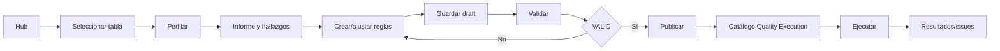
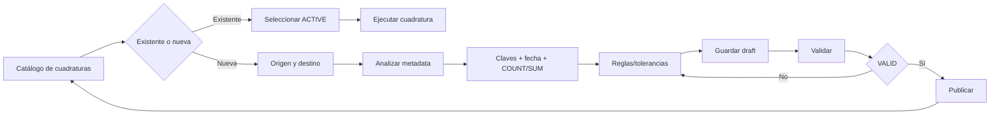

# Requerimientos funcionales — Quality & Reconciliation

**Estado:** REVIEWED  
**Fecha baseline:** 2026-08-24

## 1. Requerimientos comunes

| ID | Requerimiento | Prioridad |
|---|---|---|
| RF-COM-001 | El sistema debe usar un único frontend/BFF para Perfilamiento, Calidad y Reconciliación. | P0 |
| RF-COM-002 | El usuario debe poder navegar conexiones y metadata autorizadas sin introducir nombres técnicos manualmente cuando exista catálogo. | P0 |
| RF-COM-003 | Toda configuración debe soportar estados `DRAFT`, `ACTIVE`, `INACTIVE`, `ARCHIVED`. | P0 |
| RF-COM-004 | Toda configuración publicada debe quedar versionada e inmutable. | P0 |
| RF-COM-005 | Modificar una configuración publicada debe crear una nueva versión, preservando historial. | P0 |
| RF-COM-006 | Toda ejecución debe registrar configuration ID, version ID/number, requested_by/origin, timestamps y modo de ejecución. | P0 |
| RF-COM-007 | El usuario debe poder consultar historial de versiones y estado actual. | P1 |
| RF-COM-008 | El sistema debe permitir desactivar/reactivar sin eliminar historial. | P0 |
| RF-COM-009 | El archivado debe ser lógico y no eliminar evidencia histórica. | P0 |
| RF-COM-010 | El BFF debe mostrar errores reales de backend y no simular éxito con datos locales. | P0 |
| RF-COM-011 | `Guardar borrador`, `Validar` y `Publicar` deben ser operaciones funcionalmente separadas y trazables. | P0 |
| RF-COM-012 | Una validación satisfactoria solo aplica al payload/versión validado; si cambia la configuración debe repetirse o invalidarse la validación. | P0 |
| RF-COM-013 | Una configuración publicada y `ACTIVE` debe quedar disponible en el catálogo de ejecución del mismo dominio. | P0 |

## 1.1 Flujos funcionales de referencia

### Perfilamiento y Calidad

### Reconciliación / Cuadratura

La descripción detallada y catalogación de capturas se mantiene en [`ui-journey-evidence.md`](ui-journey-evidence.md).

## 2. Perfilamiento y calidad

| ID | Requerimiento | Prioridad | Cobertura actual |
|---|---|---|---|
| RF-DQ-001 | Seleccionar conexión, dataset y tabla a perfilar. | P0 | IMPLEMENTED |
| RF-DQ-002 | Seleccionar opcionalmente columnas específicas. | P0 | IMPLEMENTED |
| RF-DQ-003 | Ejecutar perfil actual de tabla y obtener filas, nulos, cardinalidad y estadísticas numéricas. | P0 | IMPLEMENTED |
| RF-DQ-004 | Ejecutar perfil histórico mediante `business_date`, rango, filtro o snapshot soportado por la fuente. | P0 | GAP |
| RF-DQ-005 | Persistir el contexto/corte utilizado para poder comparar perfiles en el tiempo. | P1 | GAP |
| RF-DQ-006 | Crear un draft de configuración de calidad asociado a la tabla perfilada. | P0 | IMPLEMENTED |
| RF-DQ-007 | Crear/editar reglas con dimensión, tipo, columnas, parámetros, warning, critical y severidad. | P0 | IMPLEMENTED/PARTIAL UX |
| RF-DQ-008 | Sugerir reglas a partir del perfil sin publicarlas automáticamente. | P1 | PARTIAL / TO_VALIDATE |
| RF-DQ-009 | Validar reglas y referencias antes de publicar. | P0 | IMPLEMENTED |
| RF-DQ-010 | Publicar y versionar una configuración de calidad. | P0 | IMPLEMENTED backend branch |
| RF-DQ-011 | Listar, consultar, desactivar, reactivar y archivar configuraciones. | P0 | IMPLEMENTED backend branch; UI partial |
| RF-DQ-012 | Ejecutar una configuración `ACTIVE` a demanda. | P0 | IMPLEMENTED |
| RF-DQ-013 | Ejecutar una configuración mediante programación persistente. | P0 | GAP |
| RF-DQ-014 | Consultar resultado por `execution_id` y último resultado por configuración. | P0 | IMPLEMENTED |
| RF-DQ-015 | Consultar issues/incumplimientos por regla, columna y severidad. | P1 | PARTIAL / TO_VALIDATE |
| RF-DQ-016 | Comparar calidad actual contra baseline/perfil histórico. | P1 | GAP |
| RF-DQ-017 | Desde el informe de perfilado, el usuario debe poder iniciar `Crear reglas recomendadas` conservando fuente, tabla, columnas y referencia/contexto del perfil que originó las recomendaciones. | P0 | IMPLEMENTED/PARTIAL; trazabilidad TO_VALIDATE |
| RF-DQ-018 | El informe debe mostrar métricas/hallazgos útiles para decisión —incluyendo completitud, cardinalidad, posibles claves y observaciones— basados en respuesta real del backend. | P0 | IMPLEMENTED/PARTIAL; cálculo derivado TO_VALIDATE |
| RF-DQ-019 | El usuario debe poder activar/desactivar recomendaciones, agregar reglas manuales y editar tipo, columna, nombre, dimensión y umbrales antes de guardar el draft. | P0 | IMPLEMENTED/PARTIAL UX |
| RF-DQ-020 | La UI debe impedir `Confirmar y publicar` hasta que la configuración actual tenga validación backend satisfactoria. | P0 | IMPLEMENTED visual / backend branch |
| RF-DQ-021 | Después de publicar, la configuración debe aparecer en el catálogo de Quality Execution como `ACTIVE` y ser seleccionable para ejecución. | P0 | IMPLEMENTED visual / release exacto TO_VALIDATE |
| RF-DQ-022 | La preparación de ejecución debe permitir `business_date` opcional, modo de ejecución y `requested_by`, según contrato. | P0 | IMPLEMENTED/PARTIAL |
| RF-DQ-023 | Si el frontend pierde el resultado/contexto de perfilado requerido para continuar, debe recuperar estado o exigir un nuevo perfilado explícito; no debe crear/publicar reglas con contexto incompleto. | P0 | PARTIAL / evidencia visual de recuperación |

### 2.1 Trazabilidad UI → RF

| Paso UX | Evidencia visual | RF principales |
|---|---|---|
| 1. Hub principal | `UI-DQ-01` | RF-COM-001 |
| 2. Seleccionar tabla y perfilar | `UI-DQ-02`, `UI-DQ-03`, `UI-DQ-04` | RF-DQ-001..005, RF-DQ-018 |
| 3. Crear reglas y validar | `UI-DQ-05`, `UI-DQ-06` | RF-DQ-006..009, RF-DQ-017, RF-DQ-019, RF-COM-011..012 |
| 4. Confirmar y publicar | `UI-DQ-07` | RF-DQ-010, RF-DQ-020, RF-COM-004..005 |
| 5. Ejecutar reglas | `UI-DQ-08` | RF-DQ-012..015, RF-DQ-021..022, RF-COM-006, RF-COM-013 |

## 3. Reconciliación / cuadratura

| ID | Requerimiento | Prioridad | Cobertura actual |
|---|---|---|---|
| RF-REC-001 | Seleccionar conexión, dataset/schema, tabla y columnas de origen. | P0 | IMPLEMENTED/PARTIAL |
| RF-REC-002 | Seleccionar conexión, dataset/schema, tabla y columnas de destino. | P0 | IMPLEMENTED/PARTIAL |
| RF-REC-003 | Definir claves de negocio y fecha de negocio. | P0 | IMPLEMENTED |
| RF-REC-004 | Definir métricas de conteo/suma, filtros, reglas de matching y tolerancias. | P0 | IMPLEMENTED/PARTIAL UX |
| RF-REC-005 | Crear y editar un draft mediante wizard guiado. | P0 | IMPLEMENTED en frontend V2 branch |
| RF-REC-006 | Validar metadata y parámetros antes de publicar. | P0 | IMPLEMENTED backend branch |
| RF-REC-007 | Publicar/versionar una configuración de reconciliación. | P0 | IMPLEMENTED backend branch |
| RF-REC-008 | Listar, consultar, desactivar, reactivar y archivar configuraciones. | P0 | IMPLEMENTED backend branch; UI partial |
| RF-REC-009 | Ejecutar una reconciliación `ACTIVE` a demanda para un corte de negocio. | P0 | IMPLEMENTED backend operativo |
| RF-REC-010 | Ejecutar una reconciliación mediante programación persistente. | P0 | GAP |
| RF-REC-011 | Consultar resultado y último resultado. | P0 | IMPLEMENTED backend operativo |
| RF-REC-012 | Mostrar conteos, agregados, diferencias, tolerancias y estado calculado por backend. | P0 | IMPLEMENTED/PARTIAL runtime |
| RF-REC-013 | Relacionar cada ejecución con la versión canónica exacta de configuración utilizada. | P0 | PARTIAL |
| RF-REC-014 | Permitir consulta en lenguaje natural (`ask`) solo sobre catálogo/configuraciones autorizadas. | P2 | IMPLEMENTED backend operativo / TO_VALIDATE |
| RF-REC-015 | El catálogo de reconciliación debe ofrecer dos rutas explícitas: seleccionar una configuración `ACTIVE` para ejecutar o iniciar `+ Nueva cuadratura`. | P0 | IMPLEMENTED / evidencia visual |
| RF-REC-016 | El wizard de nueva cuadratura debe preservar estado entre `Origen y destino → Análisis → Reglas → Confirmación`. | P0 | IMPLEMENTED/PARTIAL; E2E TO_VALIDATE |
| RF-REC-017 | El análisis debe identificar columnas compatibles entre origen y destino y exponer tipo/compatibilidad antes de validar/publicar. | P0 | IMPLEMENTED visual / backend TO_VALIDATE |
| RF-REC-018 | Gemini puede recomendar claves, columna de fecha y métricas `COUNT`/`SUM`, pero el usuario debe poder incluir/excluir recomendaciones antes de guardar. | P1 | IMPLEMENTED/PARTIAL |
| RF-REC-019 | El paso de reglas debe permitir definir umbrales/tolerancias y reglas de matching que se reflejen en la confirmación final. | P0 | IMPLEMENTED/PARTIAL; captura dedicada pendiente |
| RF-REC-020 | La confirmación debe mostrar resumen de proceso, dominio, origen, destino, claves, fecha, métricas, umbrales/tolerancias y responsable antes de publicar. | P0 | IMPLEMENTED / evidencia visual |
| RF-REC-021 | La UI debe separar `Guardar borrador`, `Validar configuración` y `Confirmar y publicar`. | P0 | IMPLEMENTED / evidencia visual |
| RF-REC-022 | Después de publicar, la reconciliación debe regresar/estar disponible en el catálogo como `ACTIVE` y ejecutable. | P0 | IMPLEMENTED backend; E2E TO_VALIDATE |
| RF-REC-023 | La preparación on-demand debe registrar al menos configuración, `business_date` y `requested_by` antes de ejecutar. | P0 | IMPLEMENTED/PARTIAL |

### 3.1 Trazabilidad UI → RF

| Paso UX | Evidencia visual | RF principales |
|---|---|---|
| 1. Catálogo: ejecutar existente o crear nueva | `UI-REC-01` | RF-REC-008..009, RF-REC-015, RF-REC-023 |
| 2. Origen y destino | `UI-REC-02` | RF-REC-001..002, RF-REC-005, RF-REC-016 |
| 3. Análisis y métricas | `UI-REC-03`, `UI-REC-04` | RF-REC-003..004, RF-REC-017..019 |
| 4. Confirmación/publicación | `UI-REC-05` | RF-REC-006..007, RF-REC-020..022, RF-COM-011..012 |
| 5. Ejecución | `UI-REC-01` | RF-REC-009, RF-REC-011..013, RF-REC-023, RF-COM-006 |

## 4. Scheduling común

| ID | Requerimiento | Prioridad |
|---|---|---|
| RF-SCH-001 | Crear programación asociada a una configuración y versión publicable. | P0 |
| RF-SCH-002 | Configurar frecuencia/cron y timezone. | P0 |
| RF-SCH-003 | Habilitar/deshabilitar programación sin eliminarla. | P0 |
| RF-SCH-004 | Resolver `business_date` o ventana temporal según política declarada. | P0 |
| RF-SCH-005 | Ejecutar el mismo endpoint/motor utilizado por on-demand. | P0 |
| RF-SCH-006 | Registrar `schedule_id`, trigger timestamp y `execution_mode=SCHEDULED`. | P0 |
| RF-SCH-007 | Aplicar política de reintentos e idempotencia. | P0 |
| RF-SCH-008 | Consultar próxima ejecución, última ejecución y estado del schedule. | P1 |

## 5. Regla de completitud

Un RF cambia a `IMPLEMENTED` solo cuando existe:

1. SPEC asociada;
2. contrato API o componente claramente definido;
3. código versionado en el repositorio propietario;
4. prueba automatizada apropiada;
5. evidencia de integración/runtime cuando aplique;
6. referencia de release/commit;
7. evidencia visual actualizada cuando el RF modifica el journey de usuario.
