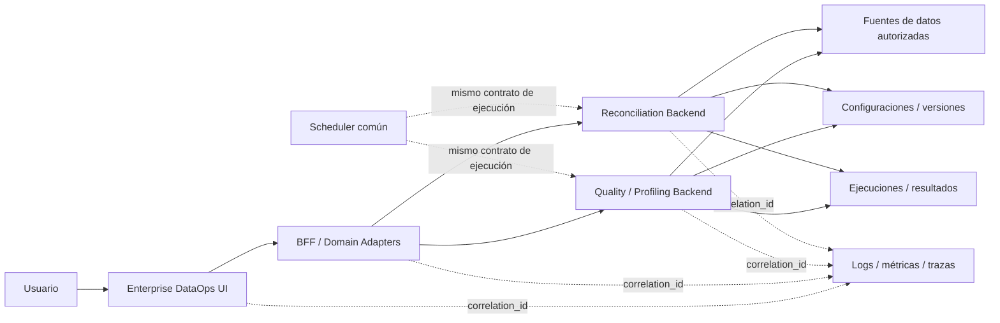

# Requerimientos no funcionales — Quality & Reconciliation

**Estado:** REVIEWED  
**Fecha baseline:** 2026-08-24

## 0. Vista transversal del journey

Los journeys visuales validados de Perfilamiento/Calidad y Reconciliación comparten la misma arquitectura de interacción: la UI guía al usuario, el BFF orquesta y el backend propietario calcula, valida, persiste y ejecuta.

Regla transversal: las capturas documentadas en [`ui-journey-evidence.md`](ui-journey-evidence.md) describen la interacción esperada, pero no autorizan lógica de negocio en frontend ni reemplazan contrato/código/pruebas.

## 1. Arquitectura y separación de responsabilidades

| ID | Requerimiento |
|---|---|
| RNF-ARC-001 | El frontend/BFF no debe implementar cálculos de perfilamiento, calidad o reconciliación. |
| RNF-ARC-002 | Cada dominio debe consumir un backend propietario mediante cliente/adaptador explícito. |
| RNF-ARC-003 | Las URLs de runtime deben configurarse por ambiente; no deben depender de una URL Cloud Run fija como contrato de producto. |
| RNF-ARC-004 | Los contratos legacy deben encapsularse en adapters y no propagarse como deuda hacia la UX. |
| RNF-ARC-005 | Quality/Reconciliation y Silver Refinement deben mantener ownership separado; no se duplicará el motor entre repositorios. |
| RNF-ARC-006 | El journey visual puede agrupar varias capacidades en una sola experiencia, pero cada acción debe delegarse al dominio/backend propietario y conservar su contrato canónico. |
| RNF-ARC-007 | El catálogo, wizard, validación, publicación y ejecución no deben mantener una segunda fuente de verdad de configuración en estado local del frontend. |

## 2. Seguridad

| ID | Requerimiento |
|---|---|
| RNF-SEC-001 | Toda invocación productiva debe usar identidad autenticada y autorización de mínimo privilegio. |
| RNF-SEC-002 | Credenciales/secretos no se almacenan en código ni repositorio; deben utilizar Secret Manager o mecanismo equivalente. |
| RNF-SEC-003 | Identificadores de proyecto/dataset/tabla/columna y filtros deben validarse antes de construir consultas. |
| RNF-SEC-004 | Las consultas generadas deben restringirse a activos y operaciones autorizadas. |
| RNF-SEC-005 | Los logs no deben exponer secretos ni datos sensibles a nivel fila salvo evidencia explícitamente gobernada. |
| RNF-SEC-006 | Toda publicación, cambio de estado y archivado debe registrar actor y timestamp. |
| RNF-SEC-007 | Recomendaciones de IA no pueden saltarse autorización, validación de metadata, validación de parámetros ni gates de publicación. |

## 3. Auditabilidad y trazabilidad

| ID | Requerimiento |
|---|---|
| RNF-AUD-001 | Toda configuración y versión debe tener identificador estable, owner, timestamps y actor. |
| RNF-AUD-002 | Toda ejecución debe registrar `execution_id`, configuración, versión, modo, parámetros, fuente/corte, estado y timestamps. |
| RNF-AUD-003 | El release debe permitir relacionar runtime con SHA de frontend/BFF y SHA del backend propietario. |
| RNF-AUD-004 | La evidencia de pruebas/smoke debe quedar versionada o referenciada desde GitHub. |
| RNF-AUD-005 | No se eliminará historial requerido para reproducir una ejecución anterior. |
| RNF-AUD-006 | Una transición visual `draft → validate → publish → execute` debe poder reconstruirse con IDs/actores/timestamps de backend, no solo con eventos de navegador. |
| RNF-AUD-007 | Cuando una recomendación de IA origine una regla, clave o métrica seleccionada, debe poder distinguirse entre `sugerida` y `confirmada por usuario` cuando el contrato lo soporte. |

## 4. Confiabilidad e idempotencia

| ID | Requerimiento |
|---|---|
| RNF-REL-001 | Crear/publicar/ejecutar debe protegerse contra duplicados por reintentos cuando la operación no sea naturalmente idempotente. |
| RNF-REL-002 | El scheduler debe poder reintentar sin crear ejecuciones duplicadas para el mismo trigger lógico. |
| RNF-REL-003 | Errores de BigQuery/backend deben propagarse como fallos explícitos; el frontend no presentará `SUCCESS` local. |
| RNF-REL-004 | Las ejecuciones deben conservar estados terminales y evidencia de error. |
| RNF-REL-005 | El control optimista (`rowVersion`, `etag` o equivalente) es obligatorio al modificar configuraciones. |
| RNF-REL-006 | El estado de un wizard debe poder recuperarse desde draft/backend o mecanismo persistente equivalente; una recarga/navegación no debe producir una configuración diferente sin advertencia. |
| RNF-REL-007 | Si se pierde el contexto necesario de un perfil o análisis, el sistema debe fallar de forma segura, conservar lo recuperable y exigir reejecución explícita antes de publicar. |
| RNF-REL-008 | Modificar un draft después de una validación debe invalidar/requerir nueva validación para evitar publicar un payload distinto al validado. |

## 5. Rendimiento y escalabilidad

| ID | Requerimiento |
|---|---|
| RNF-PERF-001 | Operaciones CRUD y metadata deben responder de forma interactiva; consultas largas no deben bloquear indefinidamente la experiencia web. |
| RNF-PERF-002 | Perfilamientos y ejecuciones de larga duración deben poder evolucionar a patrón asíncrono con `execution_id` consultable. |
| RNF-PERF-003 | El perfilamiento debe permitir limitar columnas y, cuando se implemente, estrategias de sampling configurables sin alterar silenciosamente métricas contractuales. |
| RNF-PERF-004 | El diseño debe soportar múltiples configuraciones y ejecuciones concurrentes sin compartir estado de sesión mutable entre usuarios. |
| RNF-PERF-005 | Costos de consultas deben ser observables y controlables mediante filtros, particiones, límites o políticas del motor. |
| RNF-PERF-006 | Catálogos de configuraciones y metadata deben soportar búsqueda/filtro y paginación o estrategia equivalente sin cargar indefinidamente todos los registros en el navegador. |

## 6. Observabilidad

| ID | Requerimiento |
|---|---|
| RNF-OBS-001 | Frontend/BFF/backend deben propagar correlation/trace ID. |
| RNF-OBS-002 | Deben existir métricas de solicitudes, errores, latencia, ejecuciones, duración y estado. |
| RNF-OBS-003 | Debe distinguirse ejecución `ON_DEMAND` de `SCHEDULED`. |
| RNF-OBS-004 | Cada ejecución debe registrar backend/service version cuando el runtime lo permita. |
| RNF-OBS-005 | Deben existir health checks diferenciados por dominio/backend. |
| RNF-OBS-006 | Los pasos críticos del journey —profile/analyze, save draft, validate, publish, execute— deben tener eventos/telemetría distinguibles para diagnosticar fallos de continuidad. |

## 7. Versionado y compatibilidad

| ID | Requerimiento |
|---|---|
| RNF-VER-001 | Los contratos canónicos deben documentarse con OpenAPI y pruebas de contrato. |
| RNF-VER-002 | Cambios incompatibles requieren versión explícita o estrategia de transición. |
| RNF-VER-003 | No se promoverá código a producción si el frontend espera endpoints que el backend desplegado no certifica. |
| RNF-VER-004 | GitHub será fuente de verdad del código; imágenes desplegadas deben ser reproducibles desde un commit identificable. |
| RNF-VER-005 | `main` debe representar un baseline conocido; capacidades relevantes no deben permanecer indefinidamente solo en ramas de trabajo. |
| RNF-VER-006 | Una modificación del journey debe actualizar SPEC, RF/RNF, Mermaid, evidencia visual y pruebas de integración afectadas en el mismo incremento o PR relacionado. |

## 8. UX y gobierno

| ID | Requerimiento |
|---|---|
| RNF-UX-001 | Los journeys deben ser guiados y reducir ingreso manual de identificadores técnicos. |
| RNF-UX-002 | Estados `DRAFT`, `ACTIVE`, `INACTIVE`, `ARCHIVED` deben ser visibles y consistentes. |
| RNF-UX-003 | Publicar, archivar o sobrescribir una versión debe requerir confirmación explícita. |
| RNF-UX-004 | Una sugerencia de IA/regla no debe confundirse con una regla publicada. |
| RNF-UX-005 | La UI debe explicar el resultado usando métricas calculadas por backend, sin reinterpretar silenciosamente tolerancias. |
| RNF-UX-006 | Data Profiling, Quality Rules, Quality Execution y Data Reconciliation deben conservar navegación, identidad visual y patrones de interacción consistentes dentro del mismo producto. |
| RNF-UX-007 | El paso activo de un wizard debe ser visible; pasos completados, pendientes y bloqueados deben distinguirse sin depender solo del color. |
| RNF-UX-008 | Las recomendaciones de Gemini deben indicar su naturaleza asistida y permitir aceptar, modificar o descartar antes de persistir/publicar. |
| RNF-UX-009 | `Guardar borrador`, `Validar configuración` y `Confirmar y publicar` deben tener acciones/estados visualmente distintos para evitar publicación accidental. |
| RNF-UX-010 | Ante errores recuperables, la UI debe conservar campos ya ingresados y ofrecer una acción concreta de recuperación/reintento. |
| RNF-UX-011 | Los catálogos de controles/cuadraturas deben ofrecer búsqueda y filtros suficientes para localizar una configuración sin recorrer manualmente todo el listado. |
| RNF-UX-012 | Una configuración seleccionada para ejecución debe mostrar contexto suficiente —nombre/proceso, fuente(s), estado y dominio cuando aplique— antes de habilitar ejecutar. |
| RNF-UX-013 | Campos de fecha de negocio deben mostrar formato y semántica consistentes con locale/timezone del producto y traducirse al contrato backend sin ambigüedad. |
| RNF-UX-014 | La confirmación final debe resumir el contenido material que se publicará; no debe exigir al usuario confiar en datos ocultos de pasos anteriores. |
| RNF-UX-015 | La UI debe evitar scrolls internos o tablas incontrolables cuando una alternativa paginada/responsiva preserve mejor la comprensión; la densidad de datos no debe ocultar acciones principales. |

## 9. Accesibilidad y claridad

| ID | Requerimiento |
|---|---|
| RNF-ACC-001 | Estados críticos/observados/válidos no deben comunicarse únicamente por color; deben incluir texto, icono o etiqueta. |
| RNF-ACC-002 | Controles de formulario y botones deben tener labels/nombres accesibles y foco de teclado visible. |
| RNF-ACC-003 | Los pasos del wizard, validaciones y mensajes de error deben ser comprensibles sin depender de posición visual o hover. |
| RNF-ACC-004 | La jerarquía visual debe mantener contraste legible y priorizar las acciones principales del journey. |

## 10. Datos y reproducibilidad

| ID | Requerimiento |
|---|---|
| RNF-DAT-001 | Un perfil histórico debe persistir el corte/filtro/snapshot utilizado. |
| RNF-DAT-002 | Una reconciliación debe persistir origen, destino, filtros, tolerancias y versión usados. |
| RNF-DAT-003 | Los resultados deben distinguir metadata/evidencia de configuración de los datos de negocio consultados. |
| RNF-DAT-004 | Una modificación posterior de configuración no debe cambiar retrospectivamente la interpretación de ejecuciones históricas. |
| RNF-DAT-005 | Recomendaciones derivadas de perfil/análisis deben conservar referencia suficiente al perfil, metadata o versión de análisis que las originó. |

## 11. Gate mínimo de release

Antes de promover una capacidad P0:

- build y unit tests PASS;
- contract/OpenAPI tests PASS;
- smoke contra backend real PASS;
- no fallbacks `LOCAL_*` presentados como éxito;
- SHA(s) registrados;
- matriz RF/RNF actualizada;
- Mermaid del journey actualizado cuando aplique;
- evidencia visual/capturas actualizadas cuando cambie UX;
- pruebas de continuidad del wizard o perfil→reglas cuando aplique;
- evidencia de seguridad/configuración de ambiente revisada;
- rollback definido.
