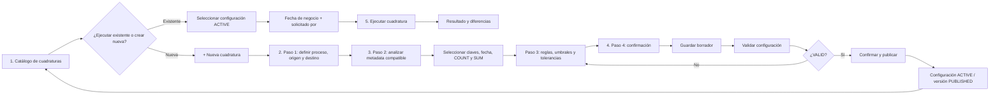

# Evidencia visual de journeys — Perfilamiento, Calidad y Reconciliación

**Estado:** REVIEWED  
**Fecha de validación visual:** 2026-08-24  
**Fuente:** capturas de la aplicación Enterprise DataOps proporcionadas y recorridas con el usuario durante la sesión de definición SDD.

## 1. Propósito

Este documento registra qué representa cada captura validada y cómo se conecta con las SPEC y requerimientos funcionales/no funcionales.

Las capturas son **evidencia visual de UX**; la fuente de verdad normativa del comportamiento continúa siendo:

- `SPEC-001-data-quality-lifecycle.md`;
- `SPEC-002-reconciliation-lifecycle.md`;
- `requirements-functional.md`;
- `requirements-non-functional.md`.

No se debe inferir una capacidad como `IMPLEMENTED` únicamente porque aparezca en una pantalla. La implementación debe mantener trazabilidad a contrato, código, pruebas y runtime.

---

# 2. Journey visual — Perfilamiento y Calidad

## UI-DQ-01 — Hub principal de agentes

La pantalla principal presenta Enterprise DataOps como un hub de capacidades y expone accesos directos a:

- perfilar datos;
- ejecutar calidad;
- ejecutar cuadratura;
- navegación lateral hacia Data Profiling, Quality Rules, Quality Execution y Data Reconciliation.

**Decisión funcional:** el journey de Calidad inicia desde un único frontend/BFF y no desde aplicaciones separadas.

## UI-DQ-02 — Selección de tabla a perfilar

El usuario selecciona:

1. conexión;
2. dataset;
3. tabla;
4. ejecuta `Analizar tabla`.

La UX debe obtener estos valores desde metadata/catálogos autorizados cuando estén disponibles.

## UI-DQ-03 — Informe inteligente de perfilado

El resultado visible incluye, entre otros:

- Data Readiness Score;
- cantidad de registros;
- cantidad de columnas;
- completitud;
- posibles claves;
- observaciones;
- hallazgos por columna;
- interpretación contextual asistida por Gemini.

**Decisión funcional:** las recomendaciones deben construirse a partir de métricas reales retornadas por backend, no de valores simulados por frontend.

## UI-DQ-04 — Hallazgos y acciones recomendadas

El detalle de columnas permite identificar:

- nulos;
- cardinalidad/distintos;
- posibles claves;
- estado de la columna;
- reglas sugeridas (`NOT_NULL`, `UNIQUE`, `ALLOWED_VALUES`, `VALUE_RANGE`, etc.);
- severidad/prioridad de hallazgos.

Desde este punto el usuario puede iniciar `Crear reglas recomendadas`.

## UI-DQ-05 — Diseño y ajuste de reglas

La configuración de Quality Rules permite:

- activar/desactivar reglas sugeridas;
- seleccionar tipo;
- seleccionar columna;
- editar nombre;
- establecer dimensión;
- configurar warning/critical;
- agregar reglas manuales;
- aplicar recomendaciones.

**Decisión de gobierno:** una sugerencia de IA no equivale a una regla publicada; el usuario mantiene control de edición y aprobación.

## UI-DQ-06 — Guardar borrador y validar configuración

La pantalla de publicación muestra un checklist de diseño y separa explícitamente:

- `Guardar borrador`;
- `Validar configuración`;
- estado de validación backend;
- datos de la configuración (nombre, descripción, responsable).

**Decisión funcional:** guardar, validar y publicar son acciones distintas.

## UI-DQ-07 — Confirmar y publicar

Solo después de una validación backend `VALID` aparece la acción explícita `Confirmar y publicar`.

**Decisión funcional:** la publicación debe generar/activar una versión canónica inmutable y trazable.

## UI-DQ-08 — Quality Execution

El catálogo de controles permite:

- listar configuraciones activas;
- buscar por nombre/dataset/tabla;
- filtrar por dominio;
- seleccionar una configuración;
- informar fecha de negocio opcional;
- identificar solicitante;
- elegir modo de ejecución;
- ejecutar evaluación.

**Decisión funcional:** la ejecución opera sobre una configuración `ACTIVE` ya publicada.

## 2.1 Flujo Mermaid validado — Perfilamiento y Calidad

```mermaid
flowchart LR
    A["1. Hub principal de agentes"] --> B["2. Seleccionar conexión, dataset y tabla"]
    B --> C["Ejecutar perfilamiento"]
    C --> D["Informe inteligente: score, métricas y hallazgos"]
    D --> E["Crear reglas recomendadas"]
    E --> F["Ajustar / agregar reglas"]
    F --> G["Guardar borrador"]
    G --> H["Validar configuración en backend"]
    H --> I{"¿VALID?"}
    I -- "No" --> F
    I -- "Sí" --> J["4. Confirmar y publicar"]
    J --> K["Configuración ACTIVE / versión PUBLISHED"]
    K --> L["5. Quality Execution: catálogo de controles"]
    L --> M["Seleccionar configuración + business_date opcional"]
    M --> N["Ejecutar evaluación"]
    N --> O["Resultado, issues y evidencia"]
```

### Recuperación de contexto

La evidencia visual muestra también un caso de recuperación donde el frontend no encuentra el resultado previo del perfilado y solicita `Ejecutar un nuevo perfilado`.

**Regla UX:** un error de contexto o navegación no debe publicar reglas con información incompleta; debe conservar el estado recuperable o forzar un nuevo perfilado explícito.

---

# 3. Journey visual — Reconciliación / Cuadratura

## UI-REC-01 — Catálogo de cuadraturas y ejecución a demanda

La pantalla principal de Data Reconciliation presenta dos rutas:

### Ruta A — Ejecutar cuadratura existente

El usuario puede:

- buscar/filtrar configuraciones;
- seleccionar una cuadratura `ACTIVA`;
- informar fecha de negocio;
- identificar solicitante;
- ejecutar la cuadratura.

### Ruta B — Crear nueva cuadratura

El usuario inicia el wizard mediante `+ Nueva cuadratura`.

**Decisión funcional:** catálogo y ejecución on-demand conviven en el mismo journey, mientras que el diseño de una nueva configuración se resuelve mediante wizard guiado.

## UI-REC-02 — Wizard paso 1: Origen y destino

El usuario define:

- nombre del proceso;
- dominio;
- descripción;
- conexión/dataset/tabla de origen;
- conexión/dataset/tabla de destino;
- filtros opcionales.

El asistente lateral mantiene un checklist de completitud.

## UI-REC-03 — Wizard paso 2: Análisis y selección de métricas

El análisis identifica metadata compatible y permite seleccionar:

- claves de negocio;
- columna de fecha;
- métricas de conteo;
- métricas de sumarización.

Gemini puede recomendar columnas/métricas, pero el usuario conserva la selección final.

## UI-REC-04 — Compatibilidad y sumarización

La continuación del análisis muestra:

- columnas numéricas candidatas a `SUM`;
- columnas compatibles origen ↔ destino;
- tipo de dato de cada lado;
- estado de compatibilidad.

**Decisión funcional:** la compatibilidad de metadata debe resolverse antes de validar/publicar la configuración.

## UI-REC-05 — Wizard paso 4: Confirmación y publicación

La confirmación muestra:

- proceso;
- dominio;
- origen;
- destino;
- claves;
- columna de fecha;
- métricas de conteo;
- métricas de sumarización;
- umbrales/tolerancias;
- responsable;
- checklist de configuración.

Las acciones se separan en:

- `Guardar borrador`;
- `Validar configuración`;
- `Confirmar y publicar`.

El wizard evidencia un paso intermedio `3. Reglas — Umbrales y tolerancias`; aunque no existe una captura independiente de ese paso en la evidencia actual, sus resultados aparecen consolidados en la confirmación final.

## 3.1 Flujo Mermaid validado — Reconciliación

---

# 4. Correspondencia de journeys

| Macroetapa | Perfilamiento y Calidad | Reconciliación |
|---|---|---|
| Descubrir/seleccionar | Fuente y tabla a perfilar | Configuración existente o nueva; origen/destino |
| Analizar | Perfil, score, nulos, cardinalidad, claves | Compatibilidad, claves, fecha, métricas |
| Diseñar control | Reglas de calidad | Reglas de matching, umbrales y tolerancias |
| Guardar | Draft de Quality | Draft de Reconciliation |
| Validar | Validación backend de reglas/configuración | Validación backend de contrato/configuración |
| Publicar | Configuración/version `ACTIVE/PUBLISHED` | Configuración/version `ACTIVE/PUBLISHED` |
| Ejecutar | Quality Execution | Cuadratura on-demand |
| Evidencia | Issues, métricas, resultado | Conteos, sumas, diferencias, tolerancias |

# 5. Regla de trazabilidad visual

Toda modificación relevante del journey deberá actualizar simultáneamente:

1. SPEC correspondiente;
2. RF afectados;
3. RNF afectados;
4. Mermaid del flujo;
5. evidencia visual/captura de UX cuando cambie la interacción;
6. pruebas E2E o smoke cuando la modificación llegue a runtime.
